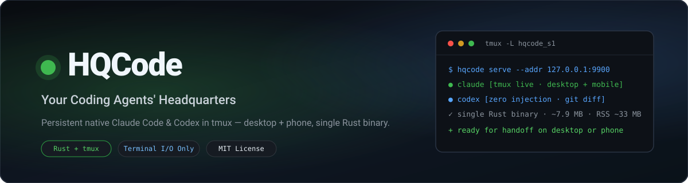
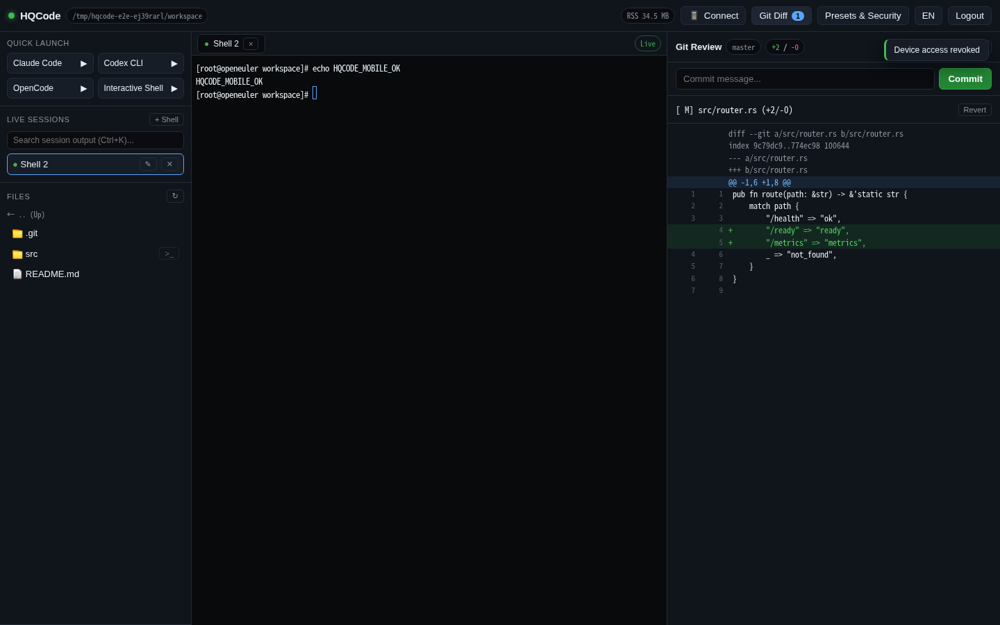
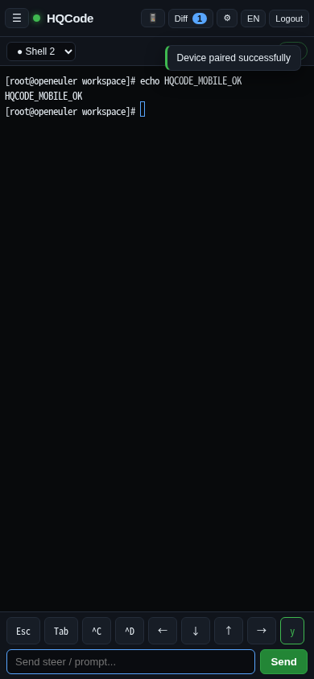
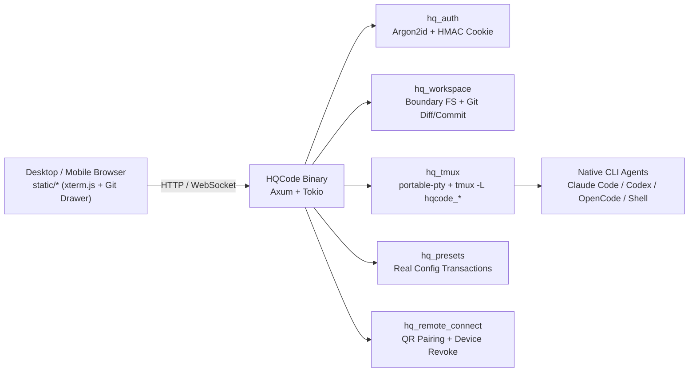
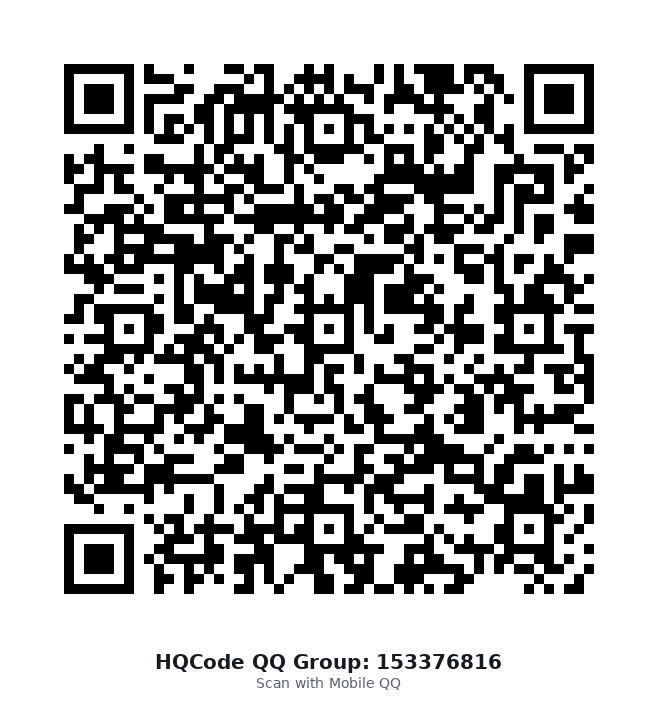

<p align="center">
  
</p>

<p align="center">
  <strong>Keep native Claude Code, Codex, OpenCode &amp; shell sessions alive in <code>tmux</code> — controlled from desktop or phone in a single Rust binary.</strong>
</p>

<p align="center">
  <a href="LICENSE"></a>
  
  
  
</p>

<p align="center">
  English | <a href="README.zh-CN.md">简体中文</a>
</p>

---

*Built in Hengqin (HQ), built to be your Agents' HQ.*

## Why HQCode?

Leaving your desk while a coding agent is mid-task is the moment fragile desktop wrappers fail. Electron and Tauri GUIs either wrap CLIs inside custom chat threads (lagging behind upstream CLI features) or drop remote connections when your laptop sleeps or your bridge restarts.

**HQCode** flips the model to **server-first, Terminal-I/O-Only**:

- **Zero Injection, 100% Native Fidelity**: Never overrides `CODEX_HOME`, `CLAUDE_CONFIG_DIR`, or wraps your agent in a lossy chat UI. You talk directly to the real `claude` / `codex` / `opencode` / shell inside `tmux`.
- **Unbreakable Persistence**: Close your browser tab, switch from workstation to phone on the train, or restart `hqcode` — your live `tmux` sessions keep running and replay full backlog cleanly on reconnect.
- **Single ~7.9 MB Rust Binary**: Powered by `Axum + Tokio + portable-pty`, zero Node/Electron runtime required, ~33 MB RSS in production tests, with embedded zero-build frontend assets.
- **Built-in Git Review Drawer**: Inspect `git status`, read line-numbered colorized unified diffs (`+N / -M`), revert individual files with two-click safety, or commit right beside your terminal — automatically tracking the active session's repository.
- **Real Mobile Oversight**: Dedicated `#hq-mobile-keys` soft toolbar (`Esc`, `Tab`, `^C`, `↑`, `↓`, `y`, `n`, `↵`, `Diff`) with `visualViewport`-aware layout so your terminal bottom never disappears behind the phone keyboard.

## Screenshots

### Desktop Control Plane (Terminal + Git Review Drawer)



### Mobile Oversight View (`390×844` with Soft-Key Bar)

<p align="center">
  
</p>

## HQCode vs Desktop Wrappers (T3 Code / Opcode / LoongCode)

| Capability | HQCode | Typical Desktop Wrappers |
| --- | --- | --- |
| **Runtime Footprint** | Single Rust binary (~7.9 MB), ~33 MB RSS | Electron / Tauri + Node/Bun bundle (150–400+ MB) |
| **Session Survival** | Native isolated `tmux` (`systemd --scope` optional); survives browser close & server restarts | Coupled to desktop app lifecycle or fragile remote relay bridge |
| **CLI Fidelity** | **Terminal I/O Only** — 100% native `claude` / `codex` / `opencode` | Re-wrapped chat UI; upstream CLI flags/TUI often lag |
| **Mobile Experience** | Browser-native `xterm.js` + `visualViewport` soft-key bar (`Esc`, `^C`, `y`, `n`, `Diff`) | Often requires separate native companion app or drops sync |
| **Code Review** | Lightweight Git Review drawer (`status`, line-numbered diff, `revert`, `commit`) | Worktree + full-page diff / PR UI |
| **License** | **MIT** | Varies (MIT / AGPL / Proprietary) |

## Quick Start

### 1. One-Line Install (Linux / macOS)

```bash
curl -fsSL https://raw.githubusercontent.com/beyondcy1013/hqcode/main/scripts/install.sh | bash
```

Start HQCode on your workstation or private server:

```bash
# Local workstation only (shows initial credentials in terminal)
hqcode serve --workspace /path/to/your/projects

# Enable LAN / Tailscale access + print scannable phone QR pairing code
hqcode serve --lan --workspace /path/to/your/projects
```

- **Phone QR Connect**: Scan the startup terminal QR code—or click **📱 Connect** in the top bar—to pair your phone once via `/pair?code=...` without typing passwords, and revoke paired devices anytime.
- **Zero-Friction CLI Utilities**:
  - `hqcode pair`: Print a fresh one-time phone pairing QR code in your terminal for a running server.
  - `hqcode doctor`: Verify `tmux`, `git`, installed Coding Agents, `PATH`, and reachable LAN/Tailscale URLs.
  - `hqcode passwd`: Reset your login password directly from the workstation CLI.

### 2. Build from Source

Prerequisites: stable Rust (2024 edition) + `tmux` (+ `git` for Git Review).

```bash
git clone https://github.com/beyondcy1013/hqcode.git
cd hqcode
cargo build --release
./target/release/hqcode serve --addr 127.0.0.1:9900 --workspace "$(pwd)"
```

### 3. Docker & systemd

- **Docker**:
  ```bash
  docker build -t hqcode .
  docker run --rm -p 9900:9900 -v "$PWD:/workspace" -v hqcode-data:/data hqcode
  ```
- **systemd**: See [contrib/hqcode.service](contrib/hqcode.service).

## CLI Preset Switching (`use` & `run`)

HQCode never isolates agents via fake `CODEX_HOME` or `CLAUDE_CONFIG_DIR` overrides. Instead, it manages real shared `~/.codex` and `~/.claude` configs transactionally:

```bash
hqcode list
hqcode use "Claude Sonnet"
hqcode run "Codex Fast" -- codex
```

- `hqcode use`: Permanently writes the selected preset to `~/.codex/config.toml` + `auth.json` or `~/.claude/settings.json`.
- `hqcode run`: Snapshots your real config, applies the target preset, launches the native CLI directly, and restores the original config after a short startup settle window.

## Architecture



HQCode's `crates/*` are fully parameterized (`TmuxNamespace`, `AuthConfig`, `WorkspaceConfig`) and shared cleanly across compatible control planes. See [docs/SHARED_CORE_ARCHITECTURE.md](docs/SHARED_CORE_ARCHITECTURE.md).

## Security

HQCode provides direct shell access and workspace file editing. Bind to `127.0.0.1` by default and expose remotely only behind TLS reverse proxy authentication, Tailscale, or a VPN. See [SECURITY.md](SECURITY.md).

## Community & Contact

- **Author QQ / WeChat**: `99739964`
- **QQ Group**: `153376816` *(Scan with mobile QQ to join directly)*

<p>
  
</p>

## License

[MIT](LICENSE) © 2026 HQCode Contributors
