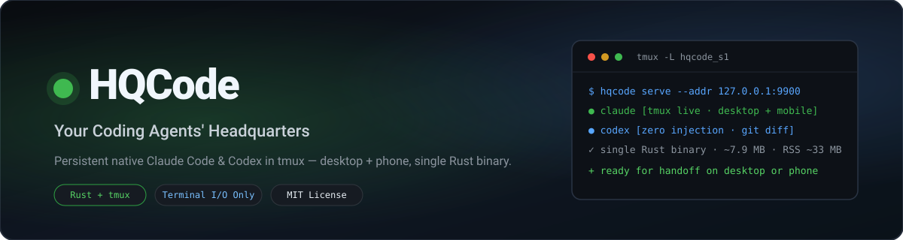
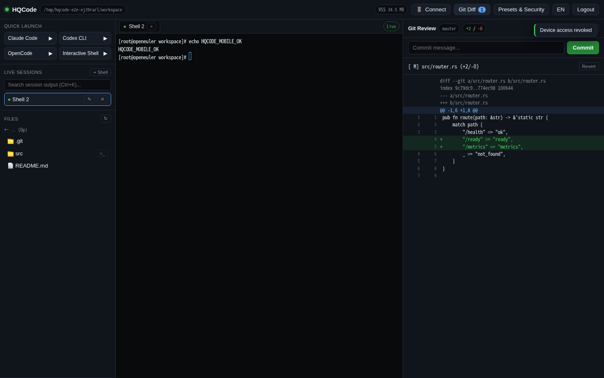
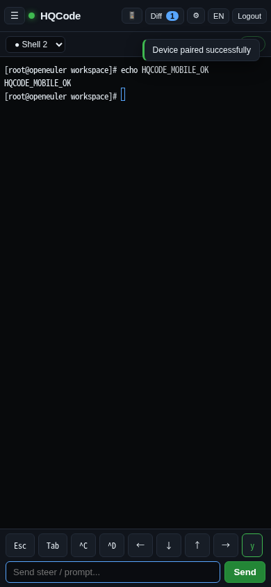

<p align="center">
  
</p>

<p align="center">
  <strong>单二进制 Rust + 原生 <code>tmux</code> 持久终端：让 Claude Code、Codex、OpenCode 与 Shell 永不断线，电脑与手机随时无缝接管同一现场。</strong>
</p>

<p align="center">
  <a href="LICENSE"></a>
  
  
  
</p>

<p align="center">
  <a href="README.md">English</a> | 简体中文
</p>

---

*Built in Hengqin (HQ), built to be your Agents' HQ.*（生于横琴 HQ，为你的 Coding Agents 打造总指挥部。）

## 为什么选择 HQCode？

当你让 Coding Agent 跑着长任务却需要离开工位时，本地桌面套壳工具的短板就会立刻暴露：要么把 CLI 魔改成滞后的聊天框，要么电脑一休眠、远程桥接一断开，手机上就完全失联。

**HQCode** 坚持 **Server-First（服务端优先）与 Terminal I/O Only（零侵入原生终端）**：

- **零注入、100% 保留原生能力**：绝不覆写 `CODEX_HOME`、`CLAUDE_CONFIG_DIR` 或注入包装提示词。上游 `claude` / `codex` / `opencode` 今天发布新功能，你今天就能直接用。
- **永不断线的会话韧性**：关掉浏览器、地铁上切手机、甚至重启 `hqcode` 服务端，底层的独立 `tmux` 会话依然活着，重连后秒级回放完整上下文。
- **单二进制极简架构**：基于 `Axum + Tokio + portable-pty`，产物仅约 **7.9 MB**、实测常驻内存约 **33 MB**，无 Electron/Node 运行时负担，前端零构建内嵌二进制。
- **内置轻量 Git 变更审阅抽屉**：终端旁随时查看 `git status`、带行号的红绿统一 Diff（`+N / -M`）、二次确认单文件 `Revert` 与快速 `Commit`，并自动跟随当前活跃终端所在目录的 Git 仓库。
- **真正好用的移动端接管体验**：内置 `#hq-mobile-keys` 软键盘栏（`Esc`、`Tab`、`^C`、`↑`、`↓`、`y`、`n`、`↵`、`Diff` 与快捷指令发送框），基于 `visualViewport` 实时适配，避免手机软键盘遮挡终端底部。

## 实机截图

### 桌面端总控台（持久终端 + 右侧 Git 变更审阅）



### 移动端远程接管（`390×844` + 底部软键盘工具栏）

<p align="center">
  
</p>

## 快速开始

### 一行安装（Linux / macOS）

```bash
curl -fsSL https://raw.githubusercontent.com/beyondcy1013/hqcode/main/scripts/install.sh | bash
```

启动服务：

```bash
hqcode serve --addr 127.0.0.1:9900 --workspace /path/to/your/projects
```

首次启动会在 `~/.hqcode/.hqcode-initial-password` 生成仅所有者可读（`0600`）的随机初始密码，首次成功登录后自动删除。

### 源码构建

依赖：稳定版 Rust（2024 edition）+ `tmux`（以及用于 Git Diff 审阅的 `git`）。

```bash
git clone https://github.com/beyondcy1013/hqcode.git
cd hqcode
cargo build --release
./target/release/hqcode serve --addr 127.0.0.1:9900 --workspace "$(pwd)"
```

### CLI 模型预设事务切换

```bash
hqcode list
hqcode use "Claude Sonnet"
hqcode run "Codex Fast" -- codex
```

- `hqcode use`：永久切换真实共享 `~/.codex` 或 `~/.claude` 配置。
- `hqcode run`：备份真实配置 → 写入目标预设 → 原生拉起 CLI → 短暂启动稳定后自动恢复原配置。

## 交流群与联系方式

- **作者 QQ / 微信**：`99739964`
- **交流 QQ 群**：`153376816`（手机 QQ 扫一扫直接加群）

<p>
  
</p>

## 安全与许可

HQCode 提供直接 Shell 执行与工作区文件编辑能力，默认监听 `127.0.0.1:9900`；如需公网或跨设备远程访问，请务必配合 TLS 反向代理认证、Tailscale 或 VPN。详见 [SECURITY.md](SECURITY.md)。

本项目基于 [MIT License](LICENSE) 开源。
